<h2>TensorFlow-FlexUNet-Image-Segmentation-CECT-Liver-Tumor-PVP (2026/10/24)</h2>
Sarah T. Arai 
Software Laboratory antillia.com  

This is the first experiment of Image Segmentation for <b>CECT Liver Tumor PVP (Portal Venous Phase) </b>
 based on
our <a href="https://github.com/sarah-antillia/TensorFlow-FlexUNet-Image-Segmentation-Model">TensorFlowFlexUNet Model</a>
 (<b>TensorFlow Flexible UNet Image Segmentation Model for Multiclass</b>) and a 256x256-pixel downscaled PNG
 <a href="https://drive.google.com/file/d/1KwYqVOgJe9si0s6fKtOGOjya2KHyyMuG/view?usp=sharing">
CECT-Liver-Tumor-ImageMask-Subset.zip</a> 
(<a href="https://creativecommons.org/publicdomain/zero/1.0/">CC0: Public Domain</a>
), 
which was derived by us from the Kaggle  
  
<a href="https://www.kaggle.com/datasets/vijayas123/cectliver-tumor-segmentation/data">
CECT Liver Tumor Segmentation PVP
</a>
  by VIJAY A S123.
  

<b>Actual Image Segmentation for CECT Liver Tumor PVP Images of 256x256 pixels</b> 
As shown below, the inferred masks resemble the ground-truth masks exceot for the third case.  
 
<b>class_color_map = {Liver: yellow, Tumor: dark_red}</b>
  
<table>
<tr>
<th width="320" height="auto">Input: image</th>
<th width="320" height="auto">Mask (ground_truth)</th>
<th width="320" height="auto">Prediction: inferred_mask</th>
</tr>
<tr>
<td>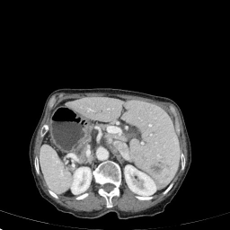</td>
<td>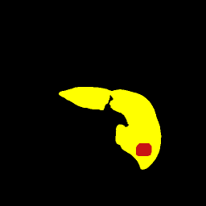</td>
<td>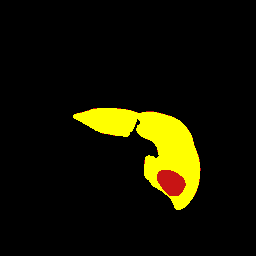</td>
</tr>
<tr>
<td>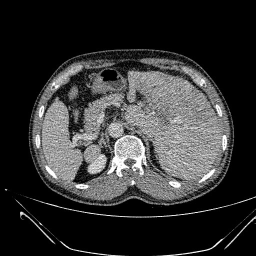</td>
<td>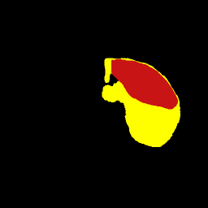</td>
<td>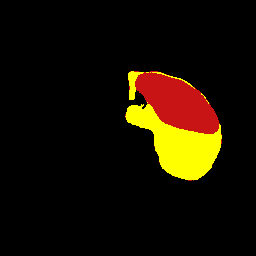</td>
</tr>
<tr>
<td>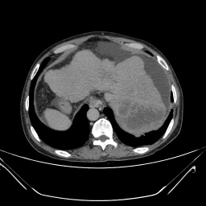</td>
<td>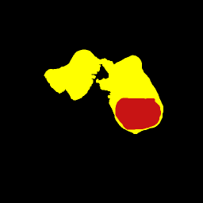</td>
<td></td>
</tr>
</table>

 
<h3>1. Dataset Citation</h3>
The dataset used here was derived from the following Kaggle:  
<a href="https://www.kaggle.com/datasets/vijayas123/cectliver-tumor-segmentation/data">
CECT Liver Tumor Segmentation PVP
</a>
  by VIJAY A S123.

  
The following explanation was taken from the website above  
<b>About Dataset</b> 
CECT Liver tumor segmentation PVP (Portal Venous Phase).
 
<b>License</b> 
<a href="https://creativecommons.org/publicdomain/zero/1.0/">CC0: Public Domain</a>
 
 
<h3>
2 CECT-Liver-Tumor-Subset Ultrasound ImageMask Dataset
</h3>
<h3>2.1 Download ImageMask Dataset</h3>
 If you would like to train this CECT Liver Tumor PVP Segmentation model,
 please download the dataset from Google Drive  
 <a href="https://drive.google.com/file/d/1KwYqVOgJe9si0s6fKtOGOjya2KHyyMuG/view?usp=sharing">
CECT-Liver-Tumor-ImageMask-Subset.zip</a>. 
Expand the downloaded ImageMaskDataset and put it under the <b>./dataset</b> folder.
 
<pre>
./dataset
└─CECT-Liver-Tumor-Subset
    ├─test
    │   ├─images
    │   └─masks
    ├─train
    │   ├─images
    │   └─masks
    └─valid
         ├─images
         └─masks
</pre>
 
<b>CECT-Liver-Tumor-Subset Statistics</b> 
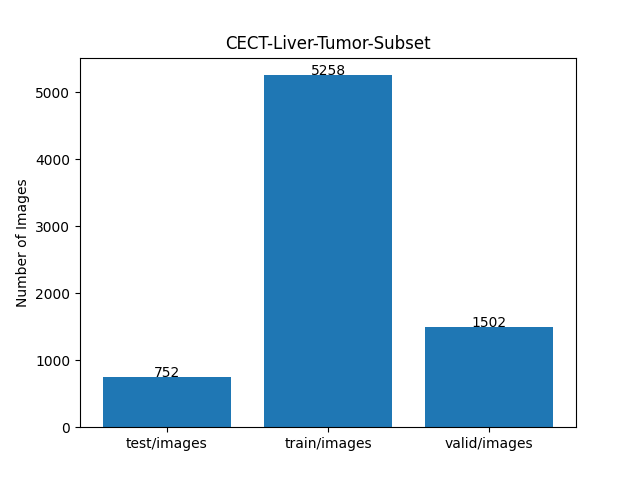 
 
As shown above, the number of images in the training and valid datasets is large enough to use for the
 training set of our segmentation model.
 
<h3>2.2 Derivation of ImageMask Dataset</h3>
The folder structure of the original facture dataset  
</a> is as follows.
<pre>
./ALL_2D_npy
 ├─P0001
 │   ├─images ( 69 NPY files)
 │   │
 │   └─masks  ( 69 NPY files)
...
  ├─P0361
  │   ├─images (198 NPY files)
  │   │
  │   └─masks  (198 NPY files)

</pre>
For simplicity and demonstration, a downscaled 256×256-pixel subset of the ImageMask dataset was generated 
from one-fifth of the original <b>ALL_2D_npy</b> data. 
The masks are color-coded, with the liver in yellow and tumors in dark red.
  
<h3>2.3 Train Sample Images and Masks</h3>
<b>Train_sample_images</b> 
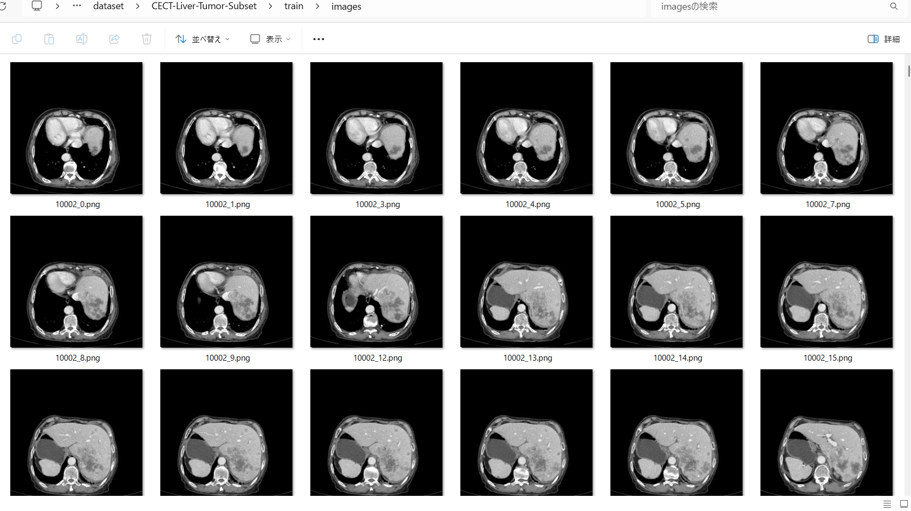
 
<b>Train_sample_masks</b> 
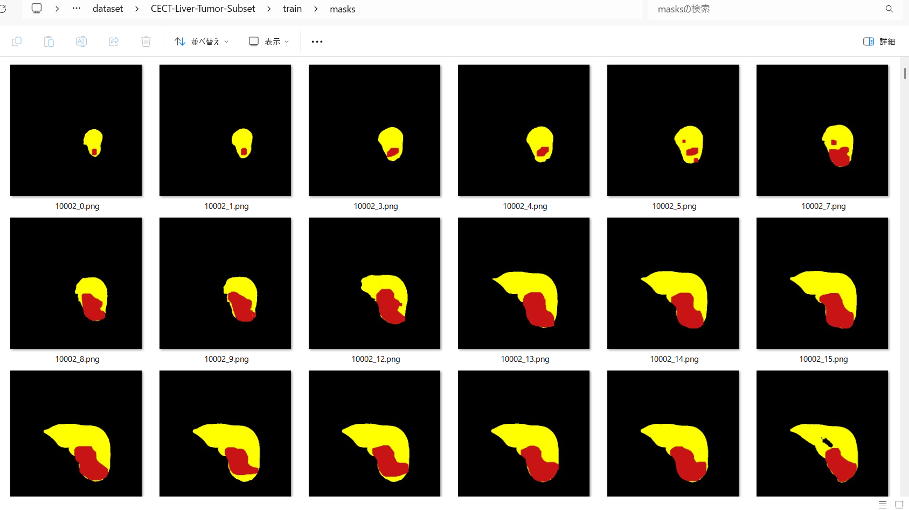
 

<h3>
3 Train TensorFlowFlexUNet Model
</h3>
 We trained the CECT-Liver-Tumor-Subset TensorFlowFlexUNet model using the following
<a href="./projects/TensorFlowFlexUNet/CECT-Liver-Tumor-Subset/train_eval_infer.config"> <b>train_eval_infer.config</b></a> file.  
Please move to ./projects/TensorFlowFlexUNet/CECT-Liver-Tumor-Subset and run the following bat file. 
<pre>
>1.train.bat
</pre>
This runs the following command. 
<pre>
>python ../../../src/TensorFlowFlexUNetTrainer.py ./train_eval_infer.config
</pre>

<b>Model parameters</b> 
Defined a small <b>base_filters=16 </b> and large <b>base_kernels=(11,11)</b> for the first Conv Layer of Encoder Block of 
<a href="./src/TensorFlowFlexUNet.py">TensorFlowFlexUNet.py</a> 
and a large <b>num_layers=8</b> (including a bridge between Encoder and Decoder Blocks).
<pre>
[model]
; You may specify your own UNet class derived from our TensorFlowFlexModel
model         = "TensorFlowFlexUNet"
generator     =  False
image_width    = 256
image_height   = 256
image_channels = 3
num_classes    = 3
base_filters   = 16
base_kernels   = (11,11)
num_layers     = 8
dropout_rate   = 0.05
; Specified a large dilation.
dilation       = (1,1)
</pre>
<b>Learning rate</b> 
Defined a small learning rate.  
<pre>
[model]
learning_rate  = 0.00007
</pre>
<b>Loss and metrics functions</b> 
Specified "categorical_focal_dice_loss" and <a href="./src/dice_coef_multiclass.py">"dice_coef_hybrid"</a>. 
<pre>
[model]
loss           = "categorical_focal_dice_loss"
metrics        = ["dice_coef_hybrid"]
hybrid_alpha   = 1.6
hybrid_beta    = 0.4
</pre>
<b>Dataset class</b> 
Specifed <a href="./src/ImageCategorizedMaskDataset.py">ImageCategorizedMaskDataset</a> class. 
<pre>
[dataset]
class_name    = "ImageCategorizedMaskDataset"
</pre>
 
<b>Learning rate reducer callback</b> 
Enabled the learning_rate_reducer callback and a small reducer_patience.
<pre> 
[train]
learning_rate_reducer = True
reducer_factor     = 0.4
reducer_patience   = 4
</pre>
<b>Early stopping callback</b> 
Enabled early stopping callback with the patience parameter.
<pre>
[train]
patience      = 10
</pre>

<b>RGB Color map</b> 
Specified RGB color map dict for CECT-Liver-Tumor-Subset 2 classes. 
<pre>
[mask]
mask_datatyoe    = "categorized"
mask_file_format = ".png"
;CECT-Liver-Tumor-Subset rgb color map dict for 1+2 classes.
;      Background: Liver:yellow, Tumor: dark_red
rgb_map = {(0,0,0):0,(255,255,0):1,(200,20,20):2}

</pre>

<b>Epoch change inference callback</b> 
Enabled <a href="./src/EpochChangeInferencer.py">epoch_change_infer callback</a></b>. 
<pre>
[train]
epoch_change_infer       = True
epoch_change_infer_dir   =  "./epoch_change_infer"
num_infer_images         = 6
</pre>

By using this callback, on every epoch change, the inference procedure can be called
 for 6 images in the <b>mini_test</b> folder. This will help you confirm how the predicted mask changes 
 at each epoch during your training process.  
  
<!--
As shown below, early in the model training, the predicted masks from our FlexUNet segmentation model showed 
discouraging results.
 However, as training progressed through the epochs, the predictions gradually improved. 
  
 --> 
 
<b>Epoch_change_inference output at starting (epoch 1,2,3)</b> 
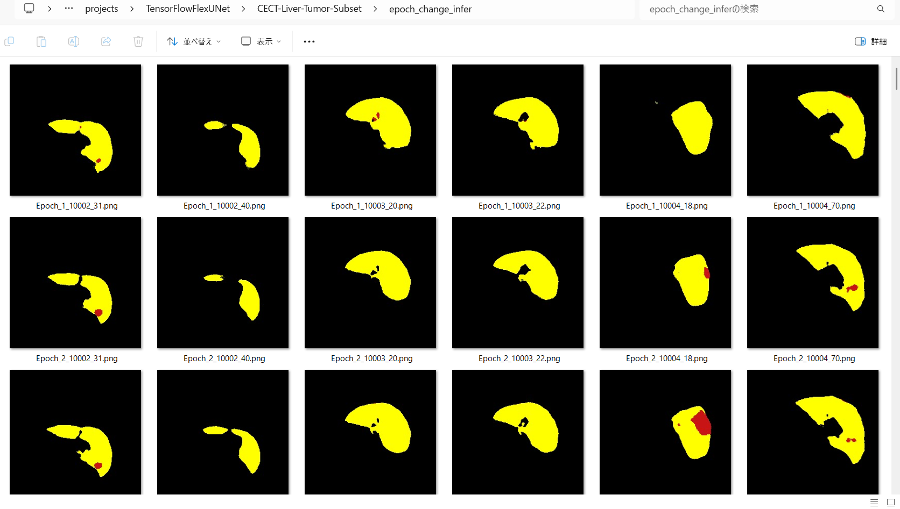 
 
<b>Epoch_change_inference output at middlepoint (epoch 25,26,27)</b> 
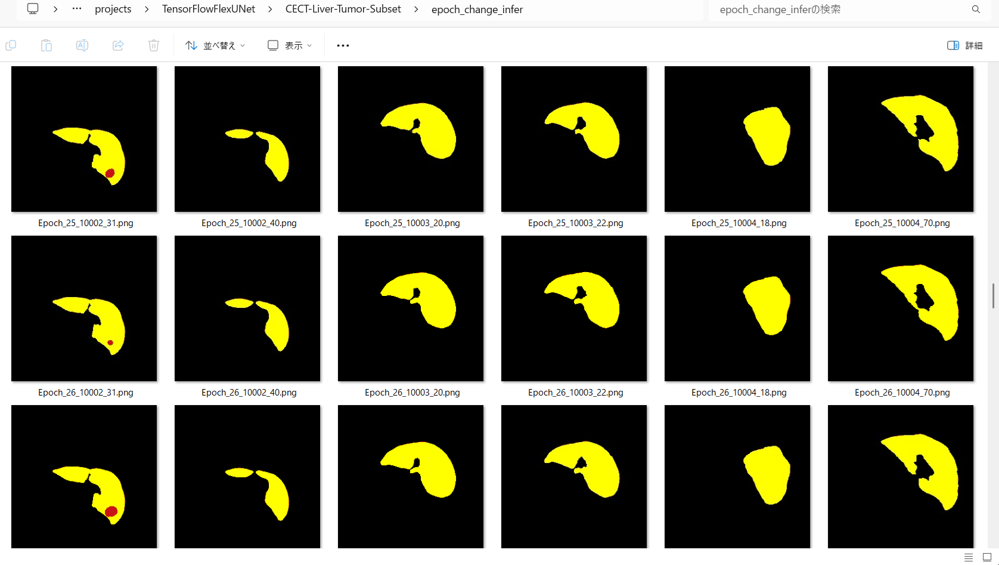 
 
<b>Epoch_change_inference output at ending (epoch 51,52,53)</b> 
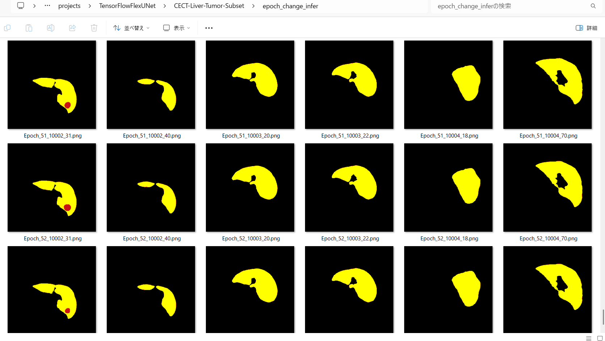 
 
In this experiment, the training process was stopped at epoch 53 by EarlyStoppingCallback. 
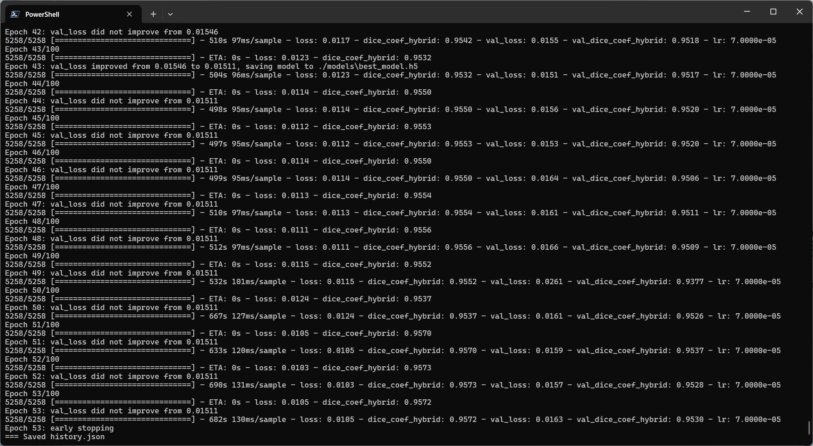 
 
<a href="./projects/TensorFlowFlexUNet/CECT-Liver-Tumor-Subset/eval/train_metrics.csv">train_metrics.csv</a> 
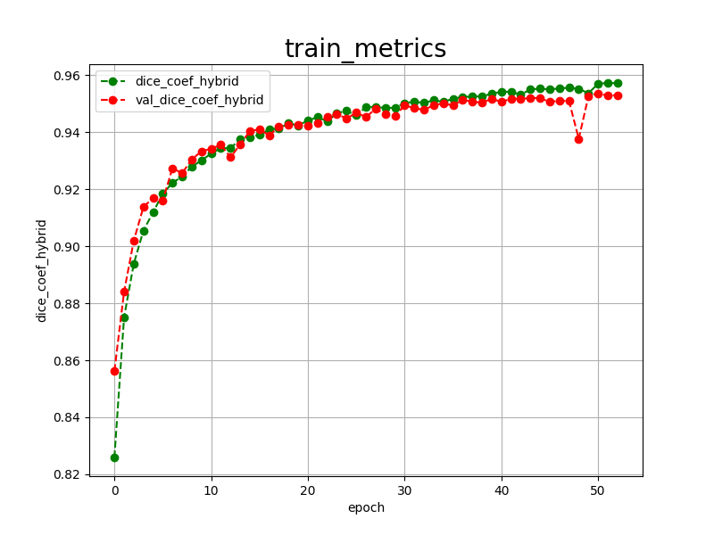 
 
<a href="./projects/TensorFlowFlexUNet/CECT-Liver-Tumor-Subset/eval/train_losses.csv">train_losses.csv</a> 
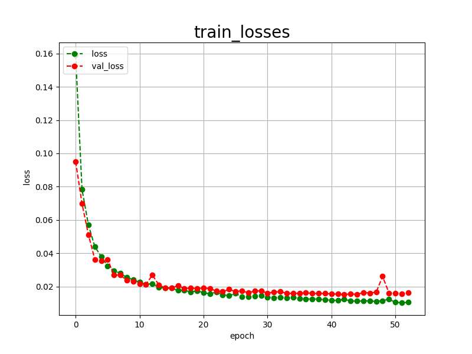 
 
<h3>
4 Evaluation
</h3>
Please move to <b>./projects/TensorFlowFlexUNet/CECT-Liver-Tumor-Subset</b> folder, 
and run the following bat file to evaluate the TensorFlowUNet model for CECT-Liver-Tumor-Subset. 
<pre>
./2.evaluate.bat
</pre>
This runs the following command.
<pre>
python ../../../src/TensorFlowFlexUNetEvaluator.py ./train_eval_infer.config
</pre>

Evaluation console output: 
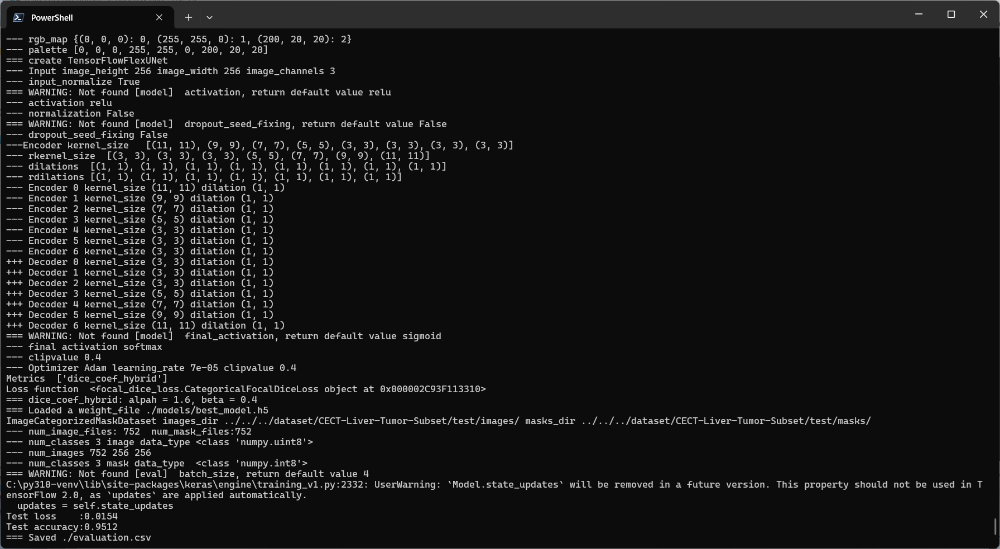
  Image-Segmentation-CECT-Liver-Tumor-Subset

<a href="./projects/TensorFlowFlexUNet/CECT-Liver-Tumor-Subset/evaluation.csv">evaluation.csv</a> 
The loss (categorical_focal_dice_loss) on this CECT-Liver-Tumor-Subset/test was low, 
and  dice_coef_hybrid was high, as shown below.
 
<pre>
categorical_focal_dice_loss,0.0154
dice_coef_hybrid,0.9512
</pre>
 

<h3>
5 Inference
</h3>
Please move to <b>./projects/TensorFlowFlexUNet/CECT-Liver-Tumor-Subset</b> folder
and run the following bat file to infer segmentation regions for images using the trained TensorFlowUNet model for CECT-Liver-Tumor-Subset. 
<pre>
./3.infer.bat
</pre>
This runs the following command.
<pre>
python ../../../src/TensorFlowFlexUNetInferencer.py ./train_eval_infer.config
</pre>

<b>mini_test_images</b> 
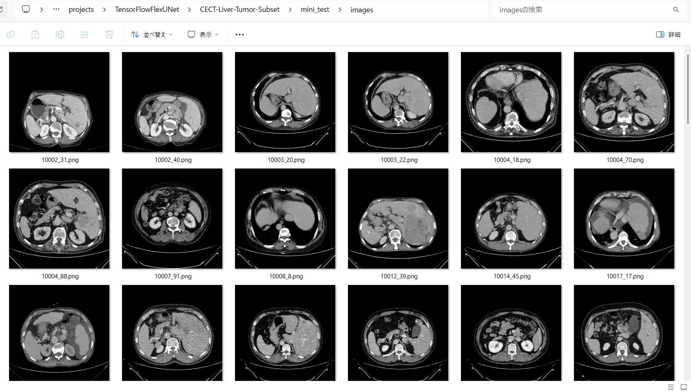 
<b>mini_test_mask(ground_truth)</b> 
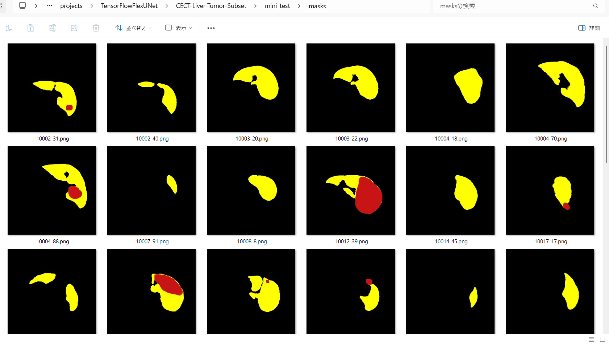 

<b>Inferred test masks</b> 
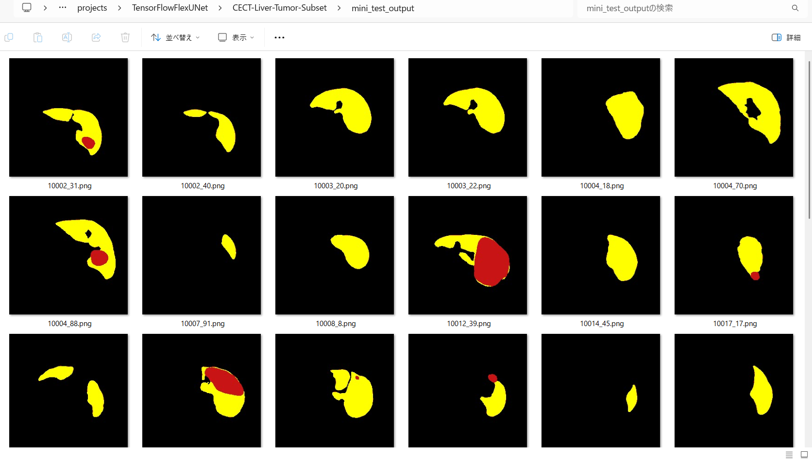 
 

<b>Enlarged images and masks for CECT Liver Tumor PVP Images of 256x256 pixels</b> 
As shown below, the inferred masks look similar to the ground truth masks. 
 
<b>class_color_map = {Liver: yellow, Tumor: dark_red}</b>
  
<table>
<tr>
<th width="320" height="auto">Image</th>
<th width="320" height="auto">Mask (ground_truth)</th>
<th width="320" height="auto">Inferred-mask</th>
</tr>
<tr>
<td>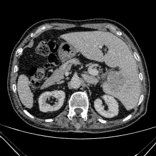</td>
<td>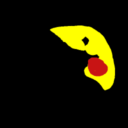</td>
<td></td>
</tr>
<tr>
<td>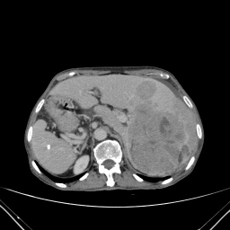</td>
<td>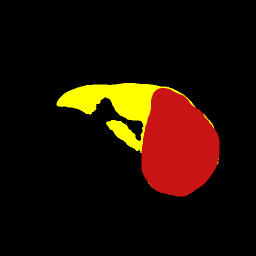</td>
<td>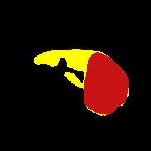</td>
</tr>
<tr>
<td>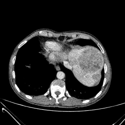</td>
<td>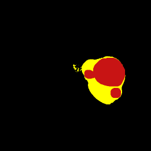</td>
<td>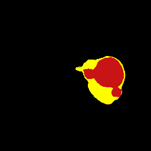</td>
</tr>
<tr>
<td>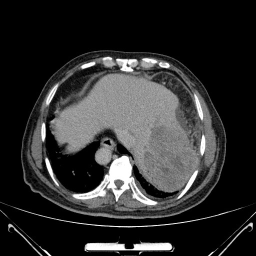</td>
<td>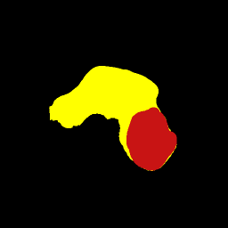</td>
<td>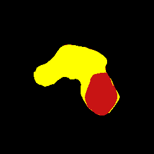</td>
</tr>
<tr>
<td>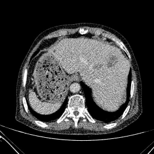</td>
<td>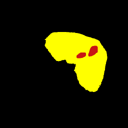</td>
<td></td>
</tr>
<tr>
<td>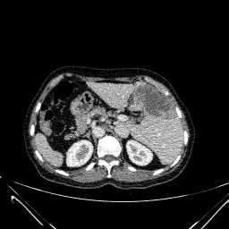</td>
<td>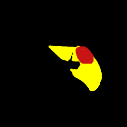</td>
<td>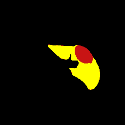</td>
</tr>
</table>

 
<h3>
References
</h3>
<b>1. Automated segmentation of liver segment on portal venous phase 
MR images using a 3D convolutional neural network</b>  
Xinjun Han, Xinru Wu, Shuhui Wang, Lixue Xu, Hui Xu, Dandan Zheng, Niange Yu, 
 Yanjie Hong, Zhixuan Yu, Dawei Yang & Zhenghan Yang 
<a href="https://link.springer.com/article/10.1186/s13244-022-01163-1">
https://link.springer.com/article/10.1186/s13244-022-01163-1</a>
 
 
<b>2. Comparative Study of UNet-based Architectures for Liver Tumor</b> 
 Segmentation in Multi-Phase Contrast-Enhanced Computed Tomography 
Doan-Van-Anh Ly, Thanh-Hai Le, Thi-Thu-Hien Pham 
<a href="https://arxiv.org/html/2510.25522v5">https://arxiv.org/html/2510.25522v5</a>
  
<b>3. Comprehensive multi-phase 3D contrast-enhanced CT imaging for primary liver cancer</b> 
Jiawei Luo, Xiaoyu Wan, Jinchao Du, Li Liu, Ling Zhao, Xin Peng, Min Wu, Shixin Huang & Xixi Nie 
<a href="https://www.nature.com/articles/s41597-025-05125-2">https://www.nature.com/articles/s41597-025-05125-2</a>
  
<b>4. TensorFlow-FlexUNet-Image-Segmentation-3Dircadb1.1-Liver-Tumor</b> 
Toshiyuki Arai 
<a href="https://github.com/sarah-antillia/TensorFlow-FlexUNet-Image-Segmentation-3Dircadb1.1-Liver-Tumor">
https://github.com/sarah-antillia/TensorFlow-FlexUNet-Image-Segmentation-3Dircadb1.1-Liver-Tumor</a>
  
<b>5. TensorFlow-FlexUNet-Image-Segmentation-Model</b> 
Toshiyuki Arai 
<a href="https://github.com/sarah-antillia/TensorFlow-FlexUNet-Image-Segmentation-Model">
https://github.com/sarah-antillia/TensorFlow-FlexUNet-Image-Segmentation-Model
</a>
  
